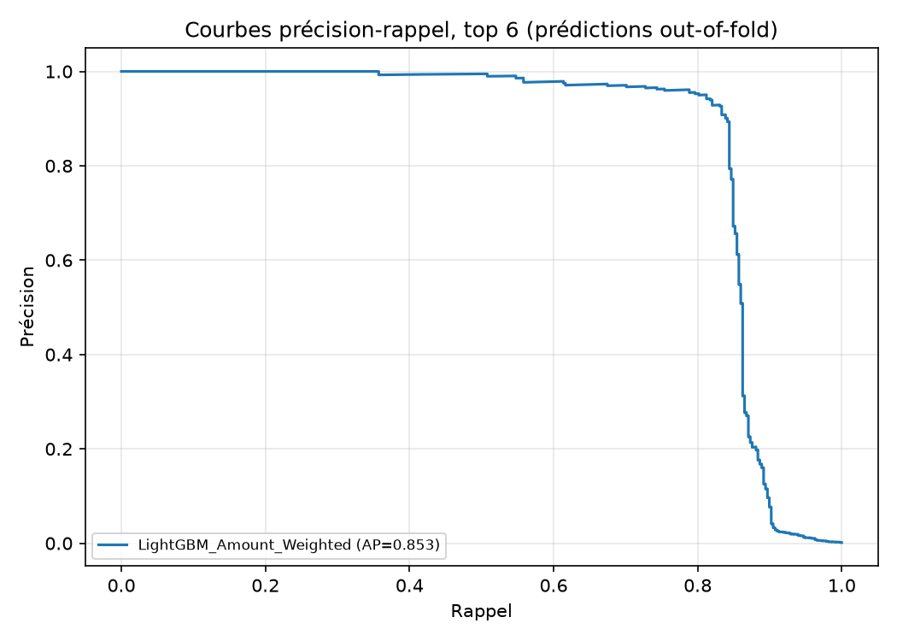
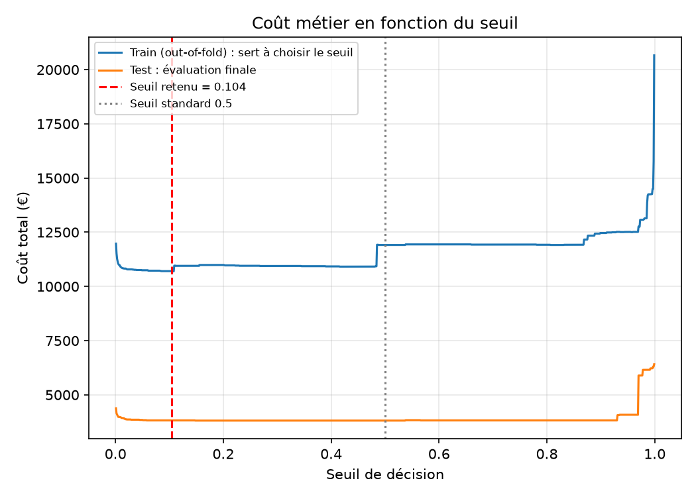
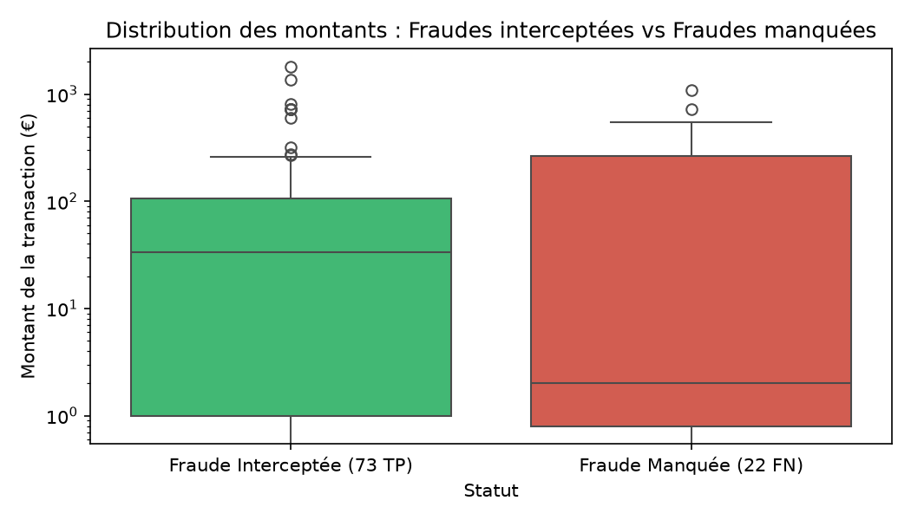

# 💳 Benchmark de Détection de Fraude Bancaire & Optimisation du Risque Financier (Cost-Sensitive Learning)

Ce projet implémente un benchmark industriel et méthodologiquement étanche de **14 architectures de Machine Learning** (modèles linéaires, bagging, boosting, stacking et approches non supervisées)[cite: 1] appliquées à la détection de fraudes par carte bancaire.

Au-delà de l'optimisation statistique pure, ce travail met en œuvre une démarche de **Cost-Sensitive Learning** où la fonction d'objectif intègre l'exposition financière réelle (montant en euros de chaque transaction)[cite: 1]. Les résultats démontrent une réduction de **74,1 % des pertes financières globales** de l'établissement[cite: 2], tout en préservant une précision opérationnelle de **96,1 %** (friction client quasi nulle)[cite: 2].

---

## 📌 Problématique Métier & Enjeux Bancaires

1. **Déséquilibre de classe extrême** : Les transactions frauduleuses représentent moins de 0,2 % du volume[cite: 5]. L'exactitude (*Accuracy*) ou la métrique ROC-AUC sont inadaptées car dominées par la classe majoritaire[cite: 5].
2. **Asymétrie des coûts d'exploitation** :
   * **Faux Positif (FP)** : Une alerte injustifiée bloque temporairement un client légitime (friction, support client, coût estimé à 10 €)[cite: 1, 5].
   * **Faux Négatif (FN)** : Une fraude manquée représente une perte financière sèche correspondant au montant intégral de la transaction détournée[cite: 1].
3. **Capacité opérationnelle contrainte** : Les analystes du centre de traitement des fraudes disposent d'un temps fini d'investigation quotidien, nécessitant d'excellentes métriques de ciblage initial (**Précision@100 / Rappel@100**)[cite: 1, 2].

---

## 📊 Données & Protocole Expérimental Rigoureux

* **Source** : [Kaggle - Credit Card Fraud Detection](https://www.kaggle.com/datasets/mlg-ulb/creditcardfraud)[cite: 1, 5]
* **Volume après déduplication** : 283 726 transactions uniques (1 081 doublons supprimés) dont 473 fraudes (taux effectif : **0,167 %**)[cite: 2].
* **Ingénierie des variables** : Remplacement de la variable `Time` brute par la composante périodique `Hour` de la journée, plus représentative des cycles d'activité humaine[cite: 1].
* **Garantie d'étanchéité (Zero Data Leakage)** :
  * Découpage stratifié Train (80 % / 226 980 transactions) et Test (20 % / 56 746 transactions)[cite: 1, 2]. Le jeu de test est figé et évalué une seule fois à la toute fin[cite: 1].
  * Validation croisée stratifiée à 5 plis (`StratifiedKFold`) menée exclusivement sur le train set[cite: 1, 2].
  * **Sélection du seuil opérationnel** calculée sur les prédictions **Out-of-Fold (OOF)** du jeu d'entraînement, sans jamais consulter les données de test[cite: 1, 2].
  * Évaluation statistique finale consolidée par **rééchantillonnage Bootstrap (300 itérations)** pour produire des intervalles de confiance à 95 %[cite: 1, 2].

---

## 🏆 Résultats du Benchmark (Validation Croisée 5-folds)

| Modèle | AP (CV Mean) | AP (CV Std) | Brier OOF | Type d'architecture |
| :--- | :---: | :---: | :---: | :--- |
| **LightGBM_Amount_Weighted** | **0.8532** | **0.0294** | 0.0004 | Boosting avec pondération par l'exposition (€)[cite: 1, 2] |
| **Extra_Trees_Balanced** | 0.8443 | 0.0332 | 0.0004 | Forêt d'arbres extrêmement aléatoires pondérée[cite: 1, 2] |
| **Random_Forest_Calibrated** | 0.8371 | 0.0297 | 0.0005 | Bagging avec calibration sigmoïde[cite: 1, 2] |
| **Random_Forest_Balanced** | 0.8365 | 0.0340 | 0.0004 | Bagging avec sous-pondération dynamique[cite: 1, 2] |
| **XGBoost_Weighted** | 0.8363 | 0.0277 | 0.0008 | Gradient Boosting régularisé (`scale_pos_weight`)[cite: 1, 2] |
| **Stacking_RF_LGBM_LR** | 0.8320 | 0.0342 | 0.0005 | Méta-classifieur logistique sur prédictions OOF[cite: 1, 2] |
| **LightGBM_SMOTE** | 0.8240 | 0.0325 | 0.0008 | Boosting sur données d'entraînement sur-échantillonnées[cite: 1, 2] |
| **CatBoost_Balanced** | 0.8081 | 0.0334 | 0.0008 | Boosting sur arbres symétriques (*oblivious trees*)[cite: 1, 2] |
| **Balanced_Random_Forest** | 0.7561 | 0.0218 | 0.0179 | Under-bagging aléatoire par sous-ensemble[cite: 1, 2] |
| **Logistic_Regression_Balanced** | 0.7439 | 0.0290 | 0.0226 | Baseline linéaire interprétable et auditable[cite: 1, 2] |
| **Voting_RF_LGBM** | 0.7310 | 0.0799 | 0.0020 | Soft Voting sans calibration[cite: 1, 2] |
| **LightGBM_Base** | 0.4052 | 0.1691 | 0.0029 | Boosting sans traitement du déséquilibre (référence négative)[cite: 1, 2] |
| **LightGBM_Weighted** | 0.1382 | 0.0524 | 0.0068 | Instabilité de calibration sur gradient asymétrique[cite: 1, 2] |
| **Isolation_Forest** | 0.1347 | 0.0186 | 0.0311 | Détection d'anomalies non supervisée (filet zero-day)[cite: 1, 2] |

<p align="center">
  
  <br/>
  <em>Figure 1 : Courbes Précision-Rappel (PR-AUC) sur les prédictions Out-Of-Fold du jeu d'entraînement.</em>
</p>

---

## 📈 Évaluation sur le Jeu de Test Indépendant (56 746 transactions)

Le modèle retenu (**`LightGBM_Amount_Weighted`**) et son seuil calibré sur les données d'entraînement (**0,104**) ont été appliqués une unique fois sur le jeu de test indépendant[cite: 1, 2] :

* **Average Precision (Test)** : **0,8125**[cite: 2]
* **Précision opérationnelle** : **96,1 %** (73 fraudes détectées pour seulement 3 faux positifs)[cite: 2]
* **Rappel** : **76,8 %** (73 fraudes stoppées sur 95)[cite: 2]
* **Précision@100 / Rappel@100** : **0,760 / 0,800** (sur les 100 alertes prioritaires envoyées aux analystes, 76 sont de véritables fraudes, couvrant 80 % du volume criminel)[cite: 2]
* **Pertes sans modèle (perte sèche brute)** : **14 766,31 €**[cite: 2]
* **Coût résiduel au seuil optimal (0,104)** : **3 822,56 €** (IC 95 % : 1 123 € à 7 398 €)[cite: 2]
* **Économie nette générée** : **74,1 %** (IC 95 % : **51,8 % à 91,8 %**)[cite: 2]

<p align="center">
  
  <br/>
  <em>Figure 2 : Fonction de coût métier selon le seuil de décision (Train OOF vs Test). On observe une large zone de stabilité opérationnelle entre 0,10 et 0,40.</em>
</p>

---

## 🔍 Audit Financier : Pourquoi le modèle a-t-il manqué 22 fraudes ?

Un audit de la distribution monétaire des transactions frauduleuses manquées (Faux Négatifs) versus interceptées (Vrais Positifs) démontre la rationalité économique du modèle :

| Statut de la transaction | Nombre | Médiane (€) | Moyenne (€) | Montant Max (€) | Total Cumulé (€) |
| :--- | :---: | :---: | :---: | :---: | :---: |
| **Fraudes Interceptées (TP)** | **73**[cite: 2] | **33,59 €**[cite: 2] | 150,33 €[cite: 2] | 1 809,68 €[cite: 2] | **10 973,75 € (74,3 %)**[cite: 2] |
| **Fraudes Manquées (FN)** | **22**[cite: 2] | **2,00 €**[cite: 2] | 172,39 €[cite: 2] | 1 096,99 €[cite: 2] | **3 792,56 € (25,7 %)**[cite: 2] |

<p align="center">
  
  <br/>
  <em>Figure 3 : Comparaison des montants unitaires (échelle log). La médiane des fraudes manquées s'écrase à 2,00 € (micro-fraudes de test de cartes).</em>
</p>

* **Priorisation du capital exposé** : Plus de 50 % des fraudes non détectées étaient des micropaiements de 1 € à 2 €[cite: 2, 4]. Engager une procédure d'alerte et de contrôle à 10 € pour bloquer une transaction de 2 € dégraderait le résultat d'exploitation[cite: 1, 2].
* **Minimisation de la friction client** : En n'abaissant pas aveuglément son seuil, le modèle maintient un taux de faux positifs quasi nul (seulement 3 clients légitimes alertés sur 56 651)[cite: 2].

---

## ⚙️ Analyse de Sensibilité du Coût de Fausse Alerte

Le seuil d'intervention reste parfaitement robuste aux variations des hypothèses de gestion interne[cite: 2] :

| Coût unitaire d'un FP (€) | Seuil optimal OOF | Coût total Test (€) | Économie générée vs sans modèle |
| :---: | :---: | :---: | :---: |
| **5 €** | 0.104[cite: 2] | 3 807,56 €[cite: 2] | 74,2 %[cite: 2] |
| **10 € (Scénario de base)** | 0.104[cite: 2] | 3 822,56 €[cite: 2] | 74,1 %[cite: 2] |
| **20 €** | 0.104[cite: 2] | 3 852,56 €[cite: 2] | 73,9 %[cite: 2] |
| **50 €** | 0.416[cite: 2] | 3 893,24 €[cite: 2] | 73,6 %[cite: 2] |

---

## 🛠️ Structure du Projet

```text
├── data/
│   └── creditcard.csv                 # Jeu de données source (ignoré par git)
├── results/
│   ├── benchmark_cv.csv               # Tableau récapitulatif de la CV 5-folds
│   ├── metrics.json                   # Métriques complètes et intervalles de confiance
│   ├── pr_curves.png                  # Courbes Précision-Rappel des modèles
│   ├── cost_vs_threshold.png          # Visualisation de la fonction de coût
│   ├── montants_fraude_tp_vs_fn.png   # Audit des distributions de montants
│   └── sensibilite_cout_fp.csv        # Données de sensibilité au coût FP
├── fraud_detection_benchmark_V2.py     # Script d'entraînement, CV, seuillage et audit
├── requirements.txt                   # Dépendances Python
└── README.md